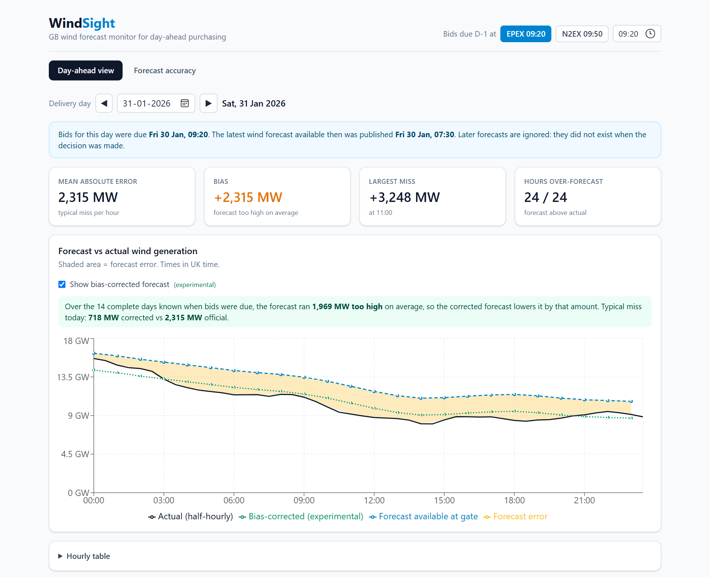
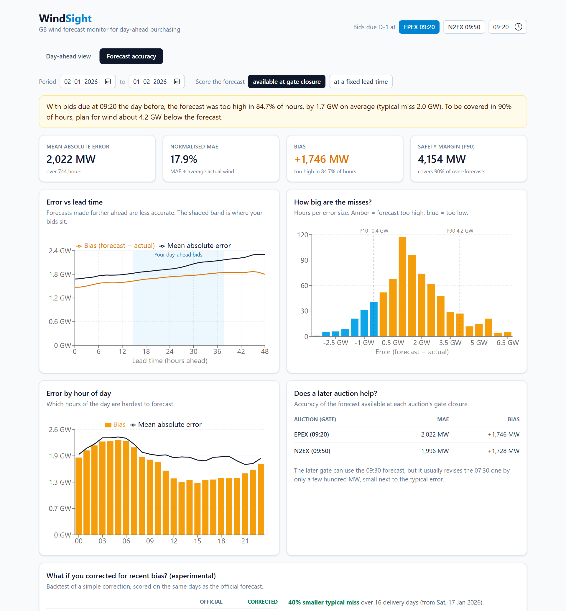

# WindSight: GB wind forecast monitor

[](https://github.com/Ivan-3101/ptl7wind/actions/workflows/ci.yml)

**Live app: https://ptl7wind.vercel.app** · API docs: https://ptl7wind.vercel.app/api/docs

A web app for a UK energy supplier's day-ahead trading team. Bids for each delivery day are
due the morning before (gate closure ~09:20 UK), so the team buys power based on **wind
forecasts**. WindSight answers two questions, using national wind data from Elexon BMRS for
purchase decisions made in **January 2026**:

1. **What did the wind forecast say when I had to decide?** The latest forecast published
   *before* gate closure, never a later one (no look-ahead).
2. **How accurate are these forecasts?** Error size and direction, how it changes with lead
   time and hour of day, and how much safety margin to plan for.

## Key findings (January 2026, forecast available at a 09:20 gate)

- The forecast was **too high in 85% of hours**, by **1.7 GW** on average (typical miss
  **2.0 GW**, 18% of average wind output).
- To be covered in 90% of hours, plan for wind about **4.2 GW below the forecast**.
- The over-forecast persists even for forecasts made just before delivery (+1.5 GW), so it is
  systematic rather than a lead-time effect. It is largest overnight (+2.3 GW at 05:00).
- The later N2EX auction (09:50 gate) improves accuracy by only ~1%: the 09:30 forecast
  usually revises the 07:30 one by just a few hundred MW.
- **Experimental:** subtracting the forecast's average error over the previous 14 complete
  days cut the typical miss by **40%** (2.1 → 1.3 GW) over 16 backtest days. Promising, but
  a small sample.

## Screenshots

| Day-ahead view | Forecast accuracy |
|---|---|
|  |  |

## How to run

The app uses a snapshot of the Elexon data committed in `data/`, so no API keys or network
access are needed to run it.

### Option 1: Docker (one command)

Requires Docker with Compose.

```bash
docker compose up --build
```

Open http://localhost:8080. The frontend container (nginx) serves the React app and forwards
`/api/*` to the backend container (FastAPI).

### Option 2: Local development

Requires Python 3.12+ and Node.js 22+.

```bash
# Backend (terminal 1), from the repo root
python -m venv .venv
source .venv/bin/activate            # Windows: .venv\Scripts\activate
pip install -r requirements-dev.txt
uvicorn app.main:app --app-dir backend --reload        # http://127.0.0.1:8000/api/docs

# Frontend (terminal 2)
cd frontend
npm ci
npm run dev                                             # http://localhost:5173
```

The Vite dev server forwards `/api/*` to the backend on port 8000.

### Tests and checks

```bash
pytest                              # 46 backend tests (from the repo root)
cd frontend && npm run lint && npm run build   # lint, type-check and production build
```

CI (GitHub Actions) runs all of the above on every push, and also builds the Docker images,
starts them with Compose and smoke-tests the app through nginx.

### Refreshing the data

```bash
python scripts/fetch_data.py        # re-downloads data/actuals.csv and data/forecasts.csv
```

## Project structure

```
.
├── api/index.py               Vercel entry point: exposes the FastAPI app as a serverless function
├── backend/
│   ├── app/
│   │   ├── data.py            Loads the CSV snapshot once (cached); drops non-forecast rows
│   │   ├── selection.py       Core rule: latest forecast published at or before a cutoff
│   │   ├── metrics.py         Bias, MAE, RMSE, nMAE, percentiles, safety margin, breakdowns
│   │   ├── correction.py      Experimental bias correction (14-day window ending D-2)
│   │   ├── schemas.py         Pydantic response models (the API contract)
│   │   └── main.py            FastAPI app: endpoints, input validation, caching
│   ├── tests/                 pytest: unit, API and reference-implementation tests
│   └── Dockerfile             Backend image (Python 3.12, uvicorn, non-root user)
├── frontend/
│   ├── src/
│   │   ├── api/               Typed API client (TanStack Query hooks) and response types
│   │   ├── views/             Day-ahead and Forecast accuracy tabs
│   │   ├── charts/            Recharts components (data in via props, no fetching)
│   │   ├── components/        Shared UI: stat cards, gate selector, comparison tables
│   │   └── format.ts          Number and UK-time formatting
│   ├── Dockerfile             Multi-stage build: Node builds the app, nginx serves it
│   └── nginx.conf             Serves the SPA and proxies /api to the backend container
├── data/                      Elexon snapshot: actuals.csv (FUELHH wind), forecasts.csv (WINDFOR)
├── scripts/fetch_data.py      Downloads the snapshot from the Elexon BMRS API
├── docs/
│   ├── DESIGN.md              Design doc: definitions, assumptions, metrics, architecture, tests
│   └── screenshots/
├── .github/workflows/ci.yml   CI: backend tests, frontend lint/build, Docker smoke test
├── docker-compose.yml         Local run: backend + frontend containers
├── vercel.json                Vercel build settings and /api rewrite
├── requirements.txt           Runtime Python dependencies (pinned)
└── requirements-dev.txt       Plus test and data-download dependencies
```

## How it works

- **Data:** Elexon BMRS
  [`FUELHH`](https://bmrs.elexon.co.uk/api-documentation/endpoint/datasets/FUELHH/stream)
  (actual generation, `fuelType = WIND`, half-hourly) and
  [`WINDFOR`](https://bmrs.elexon.co.uk/api-documentation/endpoint/datasets/WINDFOR/stream)
  (wind forecasts, hourly, ~8 publishes a day). Delivery days 2 Jan to 1 Feb 2026, the days
  bought by decisions made in January.
- **Forecast selection:** for each hour, the latest forecast with `publishTime` at or before a
  cutoff, implemented with `pandas.merge_asof`. The cutoff is either gate closure on the day
  before delivery (what the buyer actually had) or a fixed lead time (0 to 48h).
- **Accuracy:** forecasts are hourly, so they are scored against the on-the-hour actuals.
  Error = forecast − actual (positive means the forecast was too high).
- **Architecture:** React + TypeScript (Vite, Recharts, Tailwind, TanStack Query) and a FastAPI
  backend, deployed as one Vercel project: static frontend plus one Python function for
  `/api/*`.

Full details, assumptions and rejected alternatives: **[docs/DESIGN.md](docs/DESIGN.md)**.

## Use of AI tools

This project was built with the help of **Claude Code** (Anthropic's AI coding assistant),
used for code generation, data analysis and documentation. All design decisions, code and
results were reviewed and verified by me.
